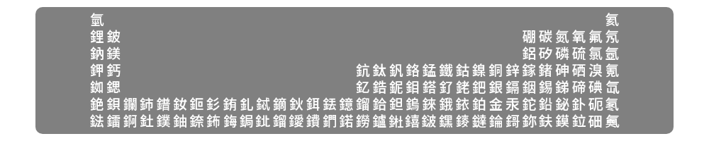
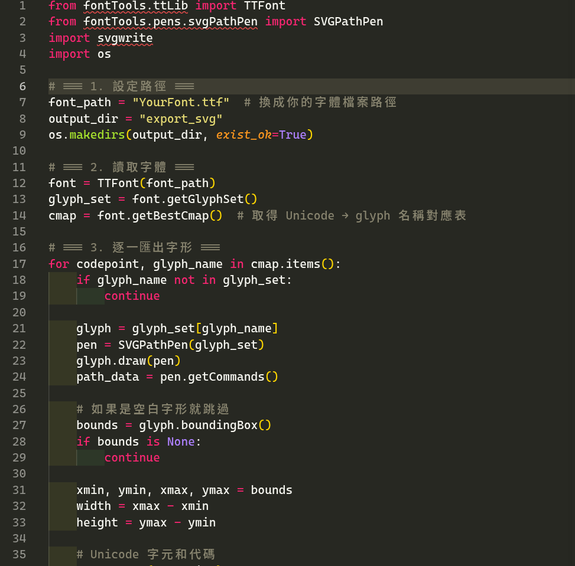

# 等寬字體漢字（及萬國碼）補充計畫

## 字體

### 此字體仍有缺字！ `Cascadia Code` 、 `Caesium` 以及 `Cascadia Code Next TC` 合成為 `Barium Mono`

此字體之用意為維持`Cascadia Code`比例。

[`Cascadia Code` / `Cascadia Code Next TC` Github](https://github.com/microsoft/cascadia-code)

[`Caesium` Github](https://github.com/alphaArgon/Caesium)

[`Barium Mono` 連結](/fonts/barium/README.md)

#### 預覽
**元素週期表（漢字）**

**程式預覽：程式由AI撰寫**

#### 設定

