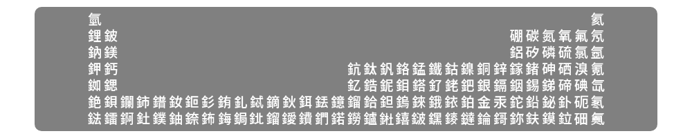
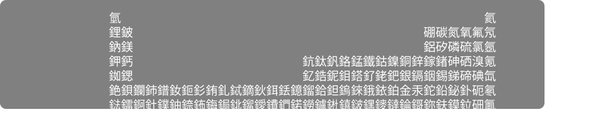

# 元素週期表預覽

安裝時應顯示：


字體顯示結果：



文字：
```
氫　　　　　　　　　　　　　　　　　　　　　　　　　　　　　　氦
鋰鈹　　　　　　　　　　　　　　　　　　　　　　　　硼碳氮氧氟氖
鈉鎂　　　　　　　　　　　　　　　　　　　　　　　　鋁矽磷硫氯氬
鉀鈣　　　　　　　　　　　　　　鈧鈦釩鉻錳鐵鈷鎳銅鋅鎵鍺砷硒溴氪
銣鍶　　　　　　　　　　　　　　釔鋯鈮鉬鎝釕銠鈀銀鎘銦錫銻碲碘氙
銫鋇鑭鈰鐠釹鉕釤銪釓鋱鏑鈥鉺銩鐿鎦鉿鉭鎢錸鋨銥鉑金汞鉈鉛鉍釙砈氡
鍅鐳錒釷鏷鈾錼鈽鋂鋦鉳鎦鑀鐨鍆鍩鐒鑪𨧀𨭎𨨏𨭆䥑鐽錀鎶鉨鈇鏌鉝鿬鿫
```
# 設定
## VS Code
```json
{
    "editor.fontFamily": "Cascadia Code, Barium Mono", // Cascadia Code 當 fallback 是因為尚未支援其他語言、連字或斜體
    "editor.fontLigatures": true, // 啟用連字（不強迫）
}
```
**注意！ `Cascadia Code` 一定要放前面！不然斜體會很醜**

